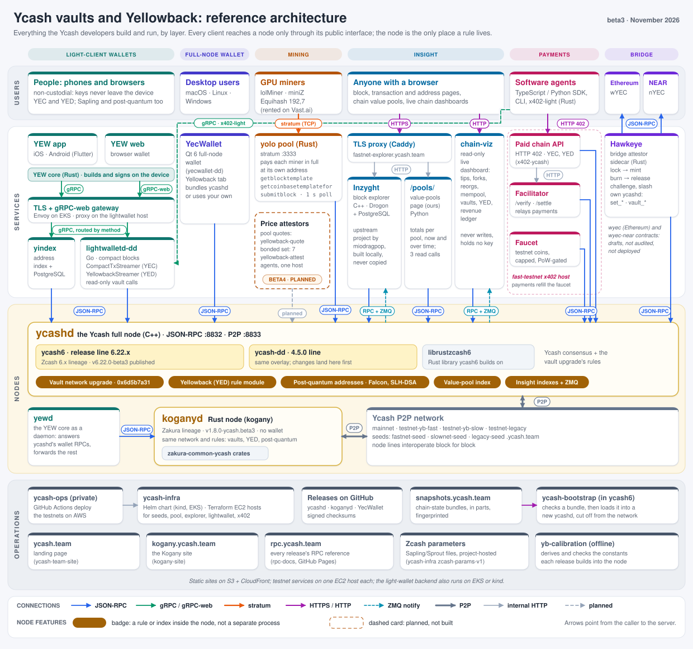

# Reference architecture

How the software of Ycash vaults and Yellowback fits together: the two node families, the services
in front of them, who uses each service, and the tooling that builds, deploys and distributes it
all. Every connection is labelled with its protocol. The picture is the beta3 state (November
2026); dashed cards are planned, not built.

Open the image on its own to read it at full size. The file is a hand-written SVG: edit it as text,
and keep each card's facts in step with the component's README.

## The layers

**Nodes.** Every rule lives in the node, and every client below reaches a node only through its
public interface. [`ycashd`](https://github.com/boyfromcave/ycash6) is the Ycash full node in
C++, built in two lines that carry the same overlay: [ycash6](https://github.com/boyfromcave/ycash6)
(the Zcash 6.x lineage, the release line, 6.22.x; built against the Rust library
[librustzcash6](https://github.com/boyfromcave/librustzcash6)) and
[ycash-dd](https://github.com/boyfromcave/ycash-dd) (the 4.5.0 line, where changes land first).
[`koganyd`](https://github.com/boyfromcave/kogany) is the Rust node (Zakura lineage, built on the
[zakura-common-ycash](https://github.com/boyfromcave/zakura-common-ycash) crates). It holds no
wallet; [`yewd`](https://github.com/boyfromcave/yew/tree/upgrade/vault/yewd), the YEW core as a
daemon, answers ycashd's wallet RPCs beside it and forwards every other call to it over JSON-RPC.
All of them follow the same Ycash P2P network and enforce the same rules: the vault network upgrade
(branch ID `0x6d5b7a31`), the Yellowback (YED) rule module and post-quantum addresses (Falcon and
SLH-DSA). From beta3 the nodes also keep a value-pool index, and an explorer node runs with the
insight indexes and ZMQ notifications. These are drawn as badges: they are features of the node,
not separate processes. No activation height is set on mainnet.

**Light-client wallets.** [YEW](https://github.com/boyfromcave/yew) is one Rust core with three
shells: the phone app (`app/`, Flutter), the browser wallet (`web/`, hosted for the fast testnet at
`fastnet-wallet.ycash.team`) and `yewd`. Keys and signing stay on the device. The app speaks gRPC
and the web wallet gRPC-web to [lightwalletd-dd](https://github.com/boyfromcave/lightwalletd)
(services `CompactTxStreamer` for YEC and `YellowbackStreamer` for YED), which reads its node over
JSON-RPC. In front sits a TLS and gRPC-web gateway: Envoy in the Kubernetes deployment of
[ycash-infra](https://github.com/boyfromcave/ycash-infra), a proxy on the single
`fastnet-lightwallet.ycash.team` host. On Kubernetes the gateway routes the address methods to
`yindex` (ycash-infra `yindex/`), an address index in PostgreSQL that ingests blocks from the node
over JSON-RPC, and a Redis cache holds the per-block `yed_*` answers.

**Full-node wallet.** [YecWallet](https://github.com/boyfromcave/yecwallet-dd) (Qt 6) bundles the
matching `ycashd` (YecWallet `v6.22.0-beta3` carries ycashd `v6.22.0-beta3`) or connects to the
user's own, and drives it over JSON-RPC; its Yellowback tab uses the `yed_*` RPCs.

**Mining.** GPU miners (lolMiner, miniZ; on the testnets rented on Vast.ai) connect over stratum to
[yolo](https://github.com/boyfromcave/yolo), a solo pool in Rust (`fastnet-pool.ycash.team:3333` on
the fast testnet). yolo polls the node every second over JSON-RPC (`getblocktemplate`, and from
beta3 `getcoinbasetemplatefor`, so each miner is paid in full at its own transparent, Sapling or
post-quantum address) and hands found blocks back with `submitblock`. It needs no node change and
can also serve koganyd's templates.

**Insight.** The explorer host (`fastnet-explorer.ycash.team`) runs a ycashd with the insight
indexes, the [Inzyght](https://github.com/miodragpop/inzyght) explorer (an upstream project by its
own author, with PostgreSQL; built locally from its repository, nothing of it copied here) and our
value-pools page under `/pools/` (ycash-infra `images/value-pools`), behind one TLS proxy. Inzyght
reads the node over JSON-RPC and follows the tip through ZMQ; the pools page makes three read-only
calls. [chain-viz](https://github.com/boyfromcave/chain-viz) is the read-only live dashboard for
operators: tips and forks across nodes, the mempool, vaults, YED and a revenue ledger, over JSON-RPC
with optional ZMQ. It never writes and holds no key.

**Payments.** [x402-ycash](https://github.com/boyfromcave/x402-ycash) lets software agents pay per
request over HTTP 402 in YEC and YED. On the fast-testnet x402 host a paid chain-data API answers
agents, a facilitator verifies and relays their payments, and a faucet hands out capped testnet
coins; all three talk to one ycashd over JSON-RPC (stock calls plus the read-only `yed_*`). Agents
that pay privately use `x402-light`, the Rust Sapling light client, which reads compact blocks
from lightwalletd-dd over gRPC.

**Bridge.** [Hawkeye](https://github.com/boyfromcave/hawkeye) is the sidecar each bridge attestor
runs next to its own ycashd (JSON-RPC, the vault primitive's `set_*` and `vault_*` calls) and an
Ethereum or NEAR endpoint (JSON-RPC). A YEC lock in a bridge vault becomes a mint of wYEC on the
[wyec](https://github.com/boyfromcave/wyec) contracts or of nYEC on the `wyec-near` contract (in
the hawkeye repository); a burn there becomes a delayed release on Ycash. Ycash consensus never
reads the other chain. The contracts are drafts: not audited, not deployed.

**Price attestors (beta4, planned).** For YED on the fast testnet: a `yellowback-quote` agent
beside the pool's node sets pool quotes, and seven `yellowback-attest` agents on one host form the
bonded attestor set, each over the node's JSON-RPC.

**Operations and distribution.** [ycash-infra](https://github.com/boyfromcave/ycash-infra) holds
the recipes (a Helm chart for kind and EKS, Terraform for the EC2 hosts: seeds, pool, explorer,
lightwallet, x402; the container images); ycash-ops, a private repository, applies them from GitHub
Actions. Releases of ycashd, koganyd and YecWallet are published on GitHub with signed checksums.
`snapshots.ycash.team` serves chain-state bundles, which `ycash-bootstrap` (ycash6
`contrib/bootstrap/`) checks against the fingerprints in its release and loads into a new ycashd
cut off from the network. The Zcash parameter files are published as ycash-infra's
`zcash-params-v1` release. The sites are [ycash.team](https://ycash.team)
([ycash-team-site](https://github.com/boyfromcave/ycash-team-site)),
[kogany.ycash.team](https://kogany.ycash.team) ([kogany-site](https://github.com/boyfromcave/kogany-site))
and the [RPC reference](https://boyfromcave.github.io/yellowback/), every release's RPCs built from
[`rpc-docs/`](../../rpc-docs/README.md) and served by GitHub Pages (`rpc.ycash.team` is its planned
custom domain). [yb-calibration](https://github.com/boyfromcave/yb-calibration) runs
offline: it derives and checks the constants each release builds into the node.

## Data paths

- **A send from the YEW web wallet.** The browser loads the wallet from `fastnet-wallet.ycash.team`;
  the YEW core syncs compact blocks from lightwalletd-dd through the gateway (gRPC-web), builds and
  signs the transaction in the browser, and submits it with `SendTransaction`; lightwalletd-dd
  passes it to its ycashd (`sendrawtransaction`), which relays it over P2P to every node, ycashd
  and koganyd alike.
- **A miner's share to a block.** The miner connects to yolo over stratum, with its own address as
  the username; yolo builds the job from the node's template (`getcoinbasetemplatefor` for that
  address), checks each share, and submits a share that meets the network target with
  `submitblock`. The node validates the block and relays it over P2P.
- **An explorer page.** The browser asks the TLS proxy at `fastnet-explorer.ycash.team`; Inzyght
  answers from its PostgreSQL index, which it fills over JSON-RPC as ZMQ announces each new block;
  `/pools/` answers from the history it samples with `getblockchaininfo` and `getblock`.
- **An agent's paid request.** The agent calls the chain API, gets `402 Payment Required` with the
  price, signs a payment and retries; the API hands the payment to the facilitator, which checks it
  against the node (`gettxout`, `signrawtransaction` with no keys as a script check) and relays it
  (`sendrawtransaction`); the API then answers from the node's read RPCs.
- **A bridge deposit.** The depositor locks YEC in a vault tagged for the bridge; each attestor's
  Hawkeye sees the confirmed lock through its own ycashd, one attestor signs the mint on Ethereum
  (or NEAR) and the others check it during the challenge window.
- **A new node from a snapshot.** `ycash-bootstrap` downloads a bundle from `snapshots.ycash.team`,
  checks its fingerprint and signature, and loads the blocks into a fresh ycashd with the network
  off; started normally, the node then syncs the rest from its peers.
